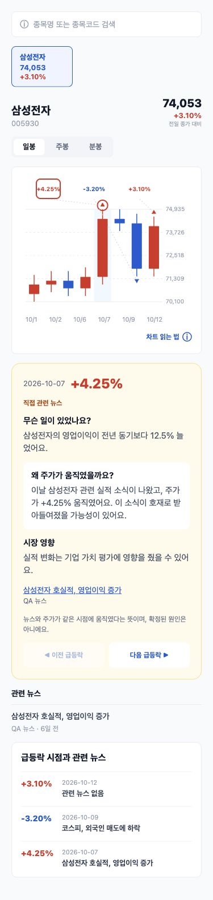
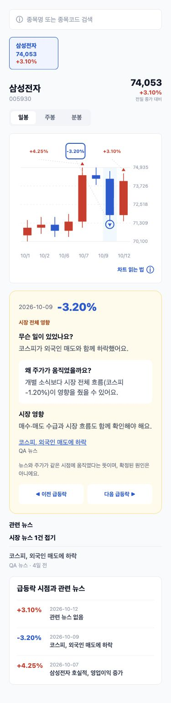
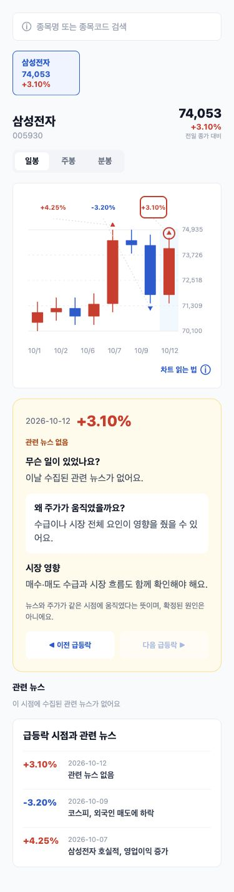

# C1/C2 차트 도슨트 QA · 2026-10-13

삼성전자 일봉을 사용한 **고정 fixture**를 실제 ChartScreen/ChartCard/CandlestickChart/ChartDocentPanel의 React Native Web 출력으로 렌더링했습니다. 실시간 가격/기사나 실제 LLM 결과를 캡처한 것은 아닙니다. 데이터 변경 없이 `node docs/chart-docent/render.cjs`로 같은 화면을 생성할 수 있습니다. 정적 렌더링 캡처이므로 실제 탭·스크롤 동작은 컴포넌트 테스트에서 확인했습니다.

## 변경 파일

- `src/screens/chart/ChartScreen/`: 최대 절대 변동 자동 선택, 노란 3단 카드, 대표 기사 이동, 시간 순 이전/다음, 관련 뉴스 바로 아래 표시, 지점 목록 날짜 내림차순·선택/스크롤. 사용하지 않는 InsightBanner 삭제.
- `src/components/CandlestickChart.tsx`: 선택 캔들 강조·마커 링, 44×36px 마커 버튼, 가격/날짜 축과 분리된 % 라벨. 진입 시 툴팁 없음.
- `src/types/api.ts`, `src/lib/api.ts`: 지점별 docent 정규화, 이전 `whyItMoved` 응답 하위호환. 첫 LLM 생성 대기를 위한 D/W timeout 180초, 분봉 90초 유지.
- `src/lib/chartDocent.ts`, 관련 테스트: 최대 지점·날짜 정렬·분봉 시각 식별·탭 선택·스크롤·이전/다음·기사 이동·터치 크기·응답 정규화 검증.

## 결과

- `npm run typecheck && npm test`: 타입 검사 성공, 53/53 통과.
- AI `pytest`: 70/70, 백엔드 `./gradlew test`: 145/145 통과. 실제 LLM은 mock.
- 375×812 viewport에서 세 화면 모두 `document.scrollWidth=375`. 가로 넘침 없음.
- 마커 44×36px, 이전/다음 44px 높이, 선택 role/label 확인.
- 실제 iOS/Android 기기와 실서비스 종합 시연은 미실행. 캐시 파일 지속 볼륨, cold LLM 지연, 뉴스 부족 시 NONE은 운영에서 확인해야 합니다.

## 진입 직후 · 최대 +4.25% 자동 선택

## 다른 지점 · -3.20% 시장 영향 선택

## 관련 뉴스 없음 · +3.10% 선택

