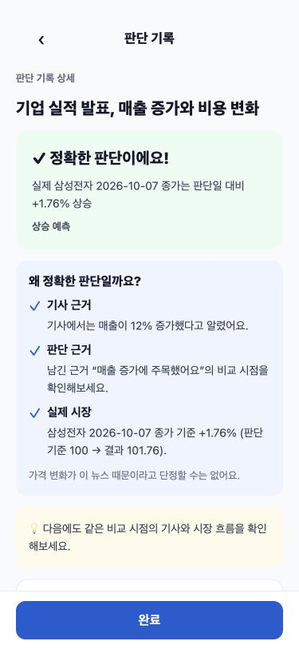
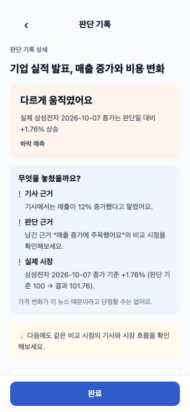
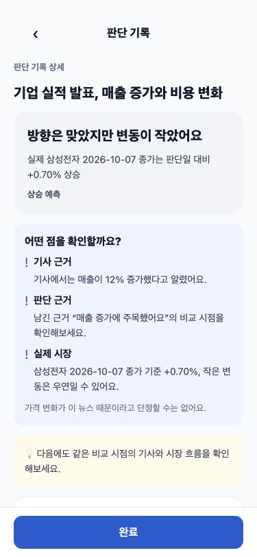
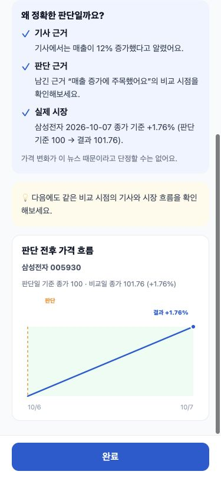
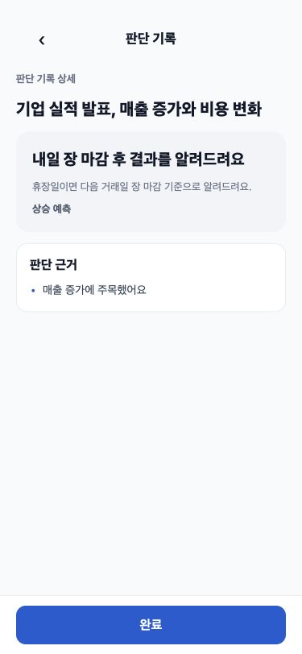

# 판단 결과 화면 QA · 2026-10-13

## 변경 / 검증

- AI: 규칙/LLM 공통 판정·헤드라인·요약·근거·다음 팁. 기사/사용자/시장 출처를 구분하고 무근거 칭찬과 새 숫자를 방지합니다. `pytest` 82개 통과(LLM mock).
- 백엔드: DTO, 두 nullable 컬럼(V9), 조건부 원자적 확정, 사용자 전용 상세 API, 목록/상세 매핑. 기존 데이터 재생성 없음. `./gradlew test` 150개 통과(별도 DB 통합 테스트 1개는 일반 실행에서 제외). 빈 PostgreSQL 16에서 prod 프로필 V1~V10 마이그레이션과 `ddl-auto=validate` 기동 테스트 통과.
- 프런트: JudgementDetailScreen의 세 상태·근거 목록·다음 팁·대기/레거시/비교 불가, MiniLineChart의 판단선/결과점/구간 강조, 고정 완료, HistoryItem의 결과 도착, feedbackSeen의 사용자별 확인 기록. API/types에서 사용자 근거와 피드백 근거를 분리합니다.
- `npm run typecheck && npm test`: 성공, 61개 통과. CORRECT/WRONG/PARTIAL UI 스냅샷, null 문단 대체, 대기/무근거/비교 불가, 상세 갱신, 필드 매핑, 사용자별 동시 확인 기록, 차트 구간/마커 검증.
- 기존 AuthRateLimiter/캐시 TTL/호출 상한 유지. 유료 LLM 호출·환경 파일 수정·운영 DB migration 실행·기존 결과 재생성 없음.

## 375px 시각 확인

실제 React Native Web 컴포넌트를 **고정 삼성전자 fixture**로 렌더링했습니다. 실서비스 데이터/실제 LLM 결과 캡처가 아닙니다. 세 결과 화면의 document.scrollWidth=375, 완료 버튼은 viewport 752~800px 위치에서 고정됩니다. 카드·완료 버튼과 스크롤 후 실제 가격 구간 강조를 확인했습니다. `node docs/judgement-feedback/render.cjs`로 HTML을 다시 생성할 수 있습니다.

| CORRECT | WRONG | PARTIAL |
|---|---|---|
|  |  |  |

## 남은 확인

- 실기기·실서비스 검증은 미실행입니다. 사용자 지정 방침에 따라 첫 V4는 유지하고 뒤 V4만 V4_1로 이름 변경했습니다(두 파일 내용 불변). 누락된 학습/일일 메모 테이블은 V10에서 멱등 생성합니다. 빈 DB 통합 검증은 통과했지만 운영 Flyway 이력은 확인 전이며 repair/baseline/SQL을 실행하지 않았습니다.
- 결과 확인 뱃지는 기기별 로컬 상태입니다. 기존 레거시 feedbackText 자체는 바꾸거나 재생성하지 않습니다.
