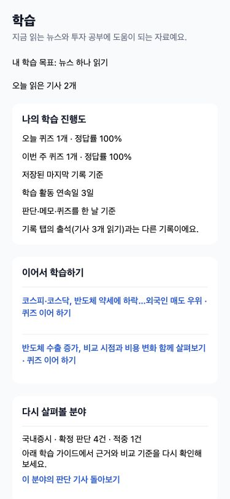
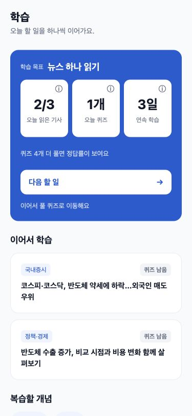
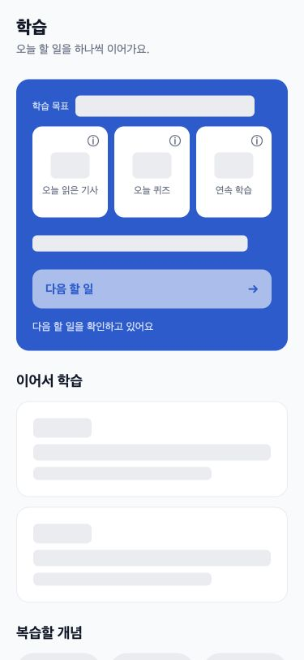
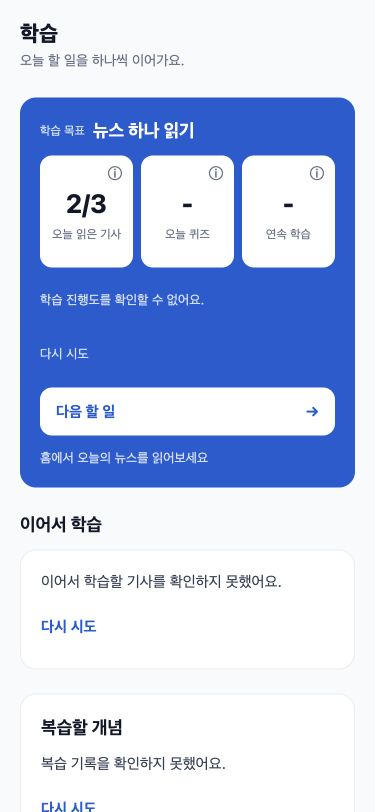
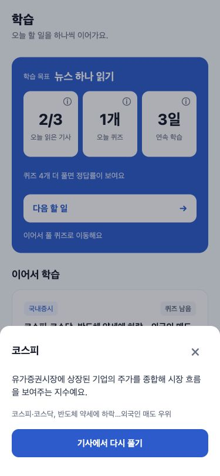
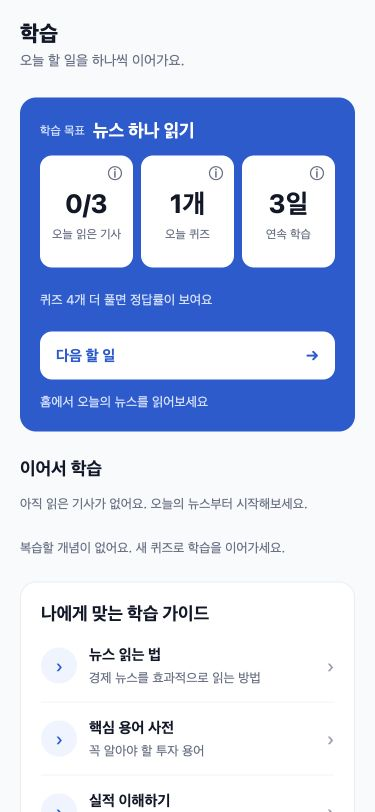

# 학습 화면 UI 검증

화면 순서를 히어로 → 이어 학습 → 복습 칩 → 가이드/팁 → 약한 분야로 정리했습니다. 숫자26px, 제목18/700, 카드 radius16/padding20을 적용하고 기준 설명은 안내 시트로 옮겼습니다. 퀴즈5개 미만에서는 정답률을 숨깁니다.

이전 검증은 실제 LearnScreen을 React Native Web로 렌더링한 동일 고정 데이터 미리보기입니다. 원격 기사/시세/LLM 요청 없이375×812에서 document.scrollWidth=375, 정상/로딩 히어로334px, 이름 없는 버튼0개를 확인했습니다. 인증이 만료되어 실서버 로그인·실기기 E2E는 수행하지 않았습니다. 이 분리 PR의 typecheck/npm test는33개 통과했으며 후속 개인화 테스트는 다음 PR에 있습니다.

| 이전 | 이후 |
|---|---|
|  |  |

| 로딩 | 오류 |
|---|---|
|  |  |

| 복습 | 빈 상태 |
|---|---|
|  |  |

실제 iOS/Android 터치·VoiceOver/TalkBack은 미검증입니다. 이번 PR의 용어 팝업은 기사ID 없이 사전 정의를 열 수 있도록 선택 필드만 먼저 분리했습니다. 수준별 문장 개인화는 후속 PR입니다.
