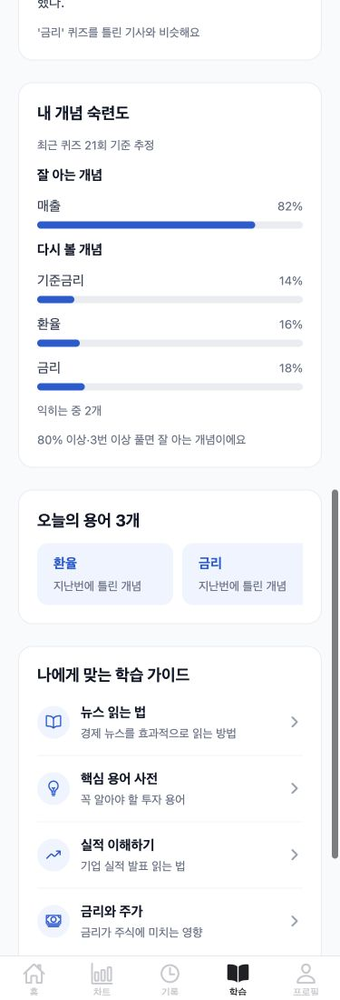
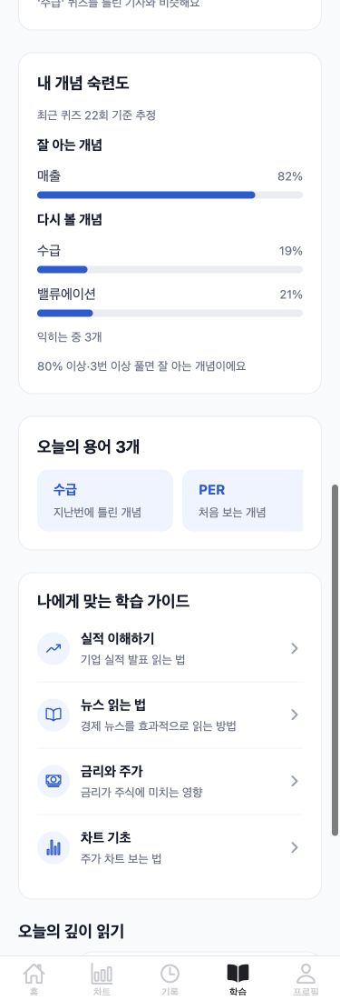
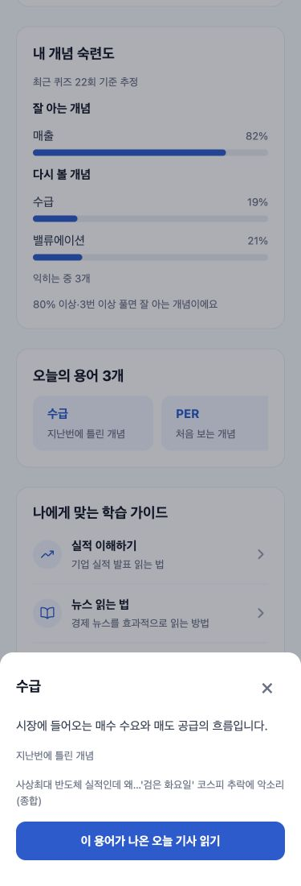

# 개념 분류·숙련도 기준·오늘의 용어 확인 (2026-10-13)

기존 BKT 식·난이도 파라미터·0.97 망각 가중·수준 제안 규칙은 유지합니다. V14로 새 kind 컬럼을 초기화하고 CONCEPT 30개 / TOPIC 7개 / MARKET 3개를 구분했습니다. TOPIC은 퀴즈·숙련도·복습·오늘의 용어에서 제외되며 원문 밑줄·설명은 유지됩니다. MARKET 퀴즈/숙련도는 초보자 응답만 허용합니다.

로컬 V14 분류 초기화 전후 term_mastery 38행·126회 및 전체 값의 digest가 동일했습니다. 뉴스 원문·판단·학습 진행 기록은 수정/재생성하지 않았습니다. 준호 어려운 점은 실제 앱 비교 동안만 terms로 변경하고 evidence로 복원했습니다. 비밀번호·키·토큰은 출력하거나 문서에 저장하지 않았습니다.

잘 아는 개념: effectivePKnown >=0.8, attempts >=3, 최근 오답 없음. 다시 볼 개념: <0.5 또는 마지막 오답. 오답이 우선되어 양쪽 중복 없음. 나머지는 익히는 중 개수로 표시합니다. 각각 최대3, 복습 칩은 같은 기준으로 최대10이며 기준 미달을 억지로 채우지 않습니다.

## 실제 API 비교

| 계정 | 잘 아는 개념 | 다시 볼 개념 | 익히는 중 | 오늘의 용어 |
|---|---|---|---:|---|
| 민지 | 매출 82% | 기준금리 14%·환율 16%·금리 18% | 2 | 환율(지난번 오답)·금리(지난번 오답)·PER(처음) |
| 준호 | 매출 82% | 수급 19%·밸류에이션 21% | 3 | 수급(지난번 오답)·PER(처음)·공시(처음) |

오늘의 용어는 BriefingService의 핵심3개 후보에서 CONCEPT만 선택하며, 숙련 개념을 제외하고 부족하면 최근24시간 기사로 확장합니다. 무관한 사전 용어로 채우지 않습니다. 민지 출처 기사 341/340, 준호 340. 프런트 바텀시트에서 정의·이유·출처 제목을 확인하고 실제 340 기사로 이동했습니다.

## 실제 375px 앱 화면

테스트용 합성 화면이 아닌 localhost:8081 앱에 두 계정으로 로그인해 캡처했습니다. 각 뷰포트/문서 폭이 375px로 같고, 용어 칩만 가로 스크롤합니다. 준호는 terms 표시 조건 비교를 위해 잠시 설정을 변경한 화면이며 이미 원래대로 복원했습니다.





## 사진 안내·도슨트 재검증

이 부분은 AI #53/backend #118에서 이미 병합됐으며 중복 구현하지 않았습니다. AI의 순수 정리 함수를 실제 news333에 적용한 첫 문장: 인공지능(AI) 열풍으로 메모리 반도체 가격이 치솟으면서 세계 스마트폰 시장에 예상치 못한 충격이 확산되고 있다. DB 원문은 여전히 사진 안내로 시작해 보존됐음을 확인했습니다.

읽기 전용 사진 패턴 SQL 집계: 46건.

```sql
SELECT count(*) FROM news
WHERE raw_content ~ '(사진은 기사와 관련 없음|사진은 기사 내용과 무관|이미지는 기사와 관련 없|자료사진|일러스트=|그래픽=|사진=)';
```

삼성전자2026-10-13 -8.08%는 news333 대신 하락 기사324를 선택하는 ChartNewsAlignmentTest 통과. 10/12는232 또는264, SK하이닉스 전시회만 있으면 NONE. 캐시 재채점 시 시세 클라이언트 미호출 테스트 통과. 기존 도슨트 캡처는 backend docs/chart-news-alignment에서 확인합니다(실제 도슨트 컴포넌트/DB 기사·사용자 재현 등락률, 전체 가격 차트 라이브 캡처는 아님).

## 테스트·남은 제한

backend ./gradlew test: JUnit180개 중 prod 전용5개 로컬 skip, 실행175개 전부 통과. Python12개 통과. backend PR120의 별도 prod-migrations CI에서 빈 PostgreSQL V1~V14 migrate+ddl-auto=validate 및 PostgreSQL 통합5개 통과. frontend npm run typecheck && npm test:80개 통과. AI pytest:130개 통과. 외부 LLM은 테스트에서 mock.

기존 시연 기록을 보존해 민지 금리는 현재18%이며 임의로25%로 맞추지 않았습니다. 준호 금리 약71%는 잘 아는 개념이 아닌 익히는 중입니다. AI·반도체를 퀴즈에서 제외하면서 이전 두 문항 승급 연출은 보장되지 않아 backend docs/demo-script.md를 갱신했습니다. 기존 시드를 자동 재실행하지 않습니다. 운영 Flyway 이력 확인/repair/운영 SQL은 실행하지 않았습니다. 모바일 실기기는 별도 확인이 필요합니다.
