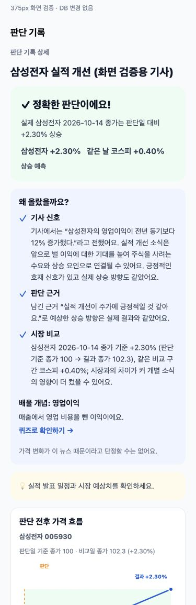
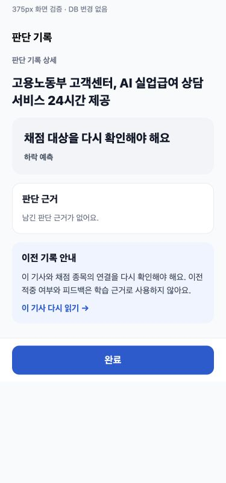

# 설명이 있는 판단 피드백 (2026-10-14)

화면은 실제 JudgementDetailScreen을 사용한 375px 렌더입니다.

상승 예시는 테스트 기사/가격으로 만든 화면 검증 데이터이며 DB에 저장하지 않았습니다. 기사 사실 → 이익 기대와 매수 수요의 연결 → 실제 방향을 설명하고 시장 비교·배울 개념을 이어 보여줍니다.

판단14/news153의 읽기 전용 데이터로 표시를 검증했습니다. TARGET_MISMATCH를 적용한 화면 예시이며 잘못된 칭찬·적중·카카오 가격 차트를 숨깁니다. 원래 DB 피드백/등락률은 수정하지 않았습니다.

타입 검사와 테스트84개 통과. 두 화면 모두 문서 너비375px로 가로 넘침 없음. 판정 불가 안내/기사 다시 읽기 및 개념 퀴즈 버튼의 접근성 role/label 확인.
