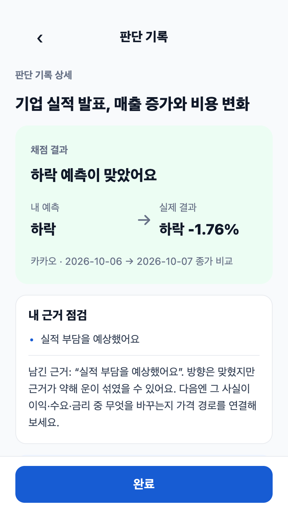

# 판단 상세 보존 검증 — 2026-10-21

이 문서는 기존 미커밋 변경의 보존 검증이에요. 제품 로직을 새로 확장하지 않았어요.

- 관심종목·학습·홈 변경은 기존 PR #145와 동일해 최종 diff에서 제외했어요.
- 판단 상세의 중복 nextTip 카드를 제거한 변경과 코칭 fixture·테스트를 보존했어요. nextTip API 필드는 그대로 유지해요.
- `npm test`: 101개 통과. `npx tsc --noEmit`: 통과.
- 375×667 CSS px, devicePixelRatio=2인 iPhone SE emulation에서 실제 TSX를 React Native Web으로 렌더링한 합성 fixture를 캡처했어요. PNG는 750×1334 physical px예요. 실제 API나 사용자 기록으로 수행한 종단 검증은 아니에요.
- before.html은 기존 origin/main의 판단 상세, after.html은 보존 브랜치의 판단 상세를 사용해요. 두 화면에는 같은 가상 카카오 가격·코칭을 제공했어요. 원래 문서의 render.cjs 로더를 사용했고 외부 호출·DB 쓰기는 없어요.
- 캡처는 화면 상단이에요. 하단 nextTip 카드 제거는 HTML과 실제 컴포넌트 회귀 테스트로 확인했어요.

