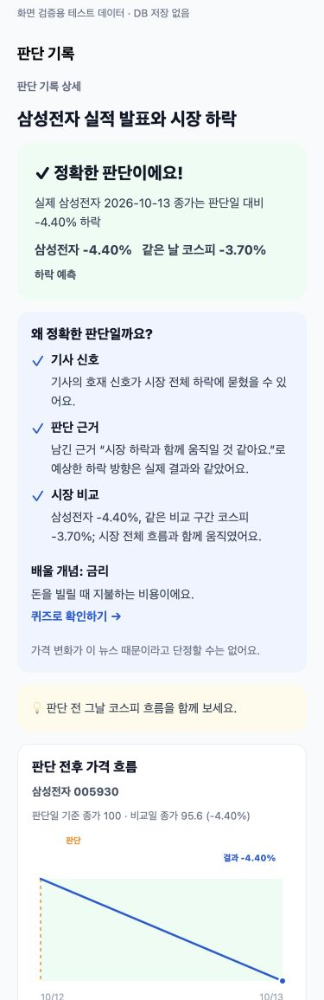

# 판단 대상·학습 피드백 개선 (2026-10-13)

- 모든 새 국내 경제 판단에 대상 저장: 별칭 매칭된 종목 우선, 코스닥만 언급하면 KOSDAQ, 나머지 국내 금융·경제 기사는 KOSPI. 해외만 다루거나 부고·내용 없는 기사에서는 판단 행동을 숨깁니다.
- 결과는 종목/지수의 같은 비교 구간 등락률, 기사 호재·악재 신호, 남긴 판단 근거, 가장 낮은 숙련도의 출제 가능한 CONCEPT, 다음 행동을 보여줍니다. 차이가 1%p 미만이면 시장 흐름, 그 이상이면 개별 요인 가능성으로 설명합니다.
- 저장된 판단 대상이 기사 매핑보다 우선입니다. 근거 없는 판단은 칭찬하지 않고 근거 남기기를 안내합니다. 비교 숫자가 없으면 숫자를 만들지 않습니다.
- 타입 검사 통과 / npm test 81개 통과. 결과·개념 버튼·대상 메타데이터·레거시 null 처리 검증.
- 375px에서 문서 너비 375px로 가로 넘침 없음. 버튼의 접근성 role/label 확인.

이 캡처는 실제 JudgementDetailScreen을 테스트 데이터로 렌더한 화면입니다. 삼성전자 -4.40%/코스피 -3.70%와 두 가격은 화면 검증용 예시이며 DB에 저장하지 않았습니다. 기존 판단은 승인 전 재채점하지 않아 현재 과거 기록에 새 피드백이 나타나지는 않습니다. 새 판단의 실제 결과는 다음 거래일 시세를 확보한 뒤 표시됩니다.
