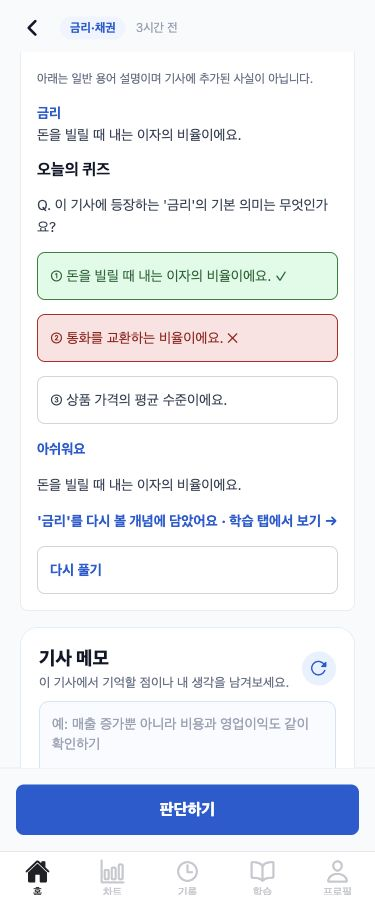
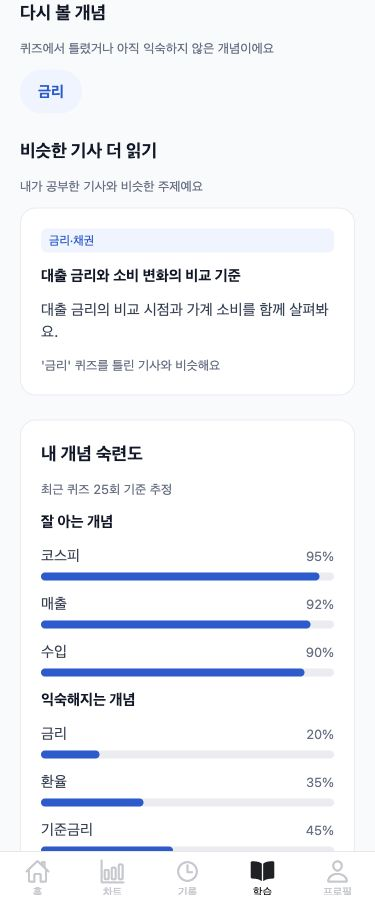
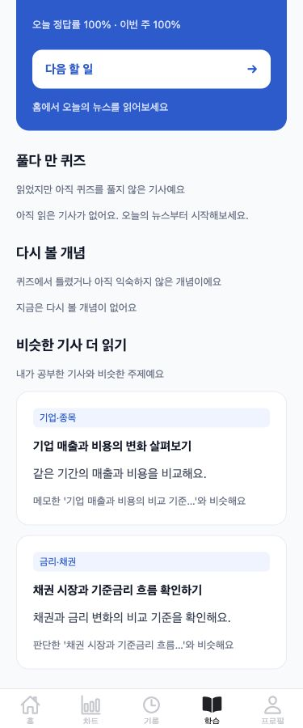

# 퀴즈 → 다시 볼 개념 → 비슷한 기사 흐름

정답 결과는 ‘정답이에요!’와 뜻만 보여주고 다시 풀기를 숨깁니다. 오답 결과는 ‘아쉬워요’, 정답 뜻, ‘다시 볼 개념에 담았어요 · 학습 탭에서 보기 →’ 링크와 다시 풀기를 표시합니다. 서버의 내부 설명은 화면에 표시하지 않습니다.

링크는 학습 탭의 ‘다시 볼 개념’ 위치로 스크롤합니다. 데이터가 준비된 뒤 실제 위치를 측정해 로딩 중 레이아웃을 지나치는 문제를 방지합니다. 개념 칩은 뜻 시트를 열고 ‘이 개념이 나온 기사 다시 풀기’는 그 기사·용어·저장된 수준의 퀴즈를 열어 퀴즈 위치로 스크롤합니다.

핵심 섹션 순서는 오늘 목표 → 풀다 만 퀴즈 → 다시 볼 개념 → 비슷한 기사 더 읽기 → 내 개념 숙련도 → 학습 가이드입니다. 세 섹션에 13px/#667085 설명을 붙였습니다. 새 섹션 카드나 박스를 추가하지 않았습니다. 기존 용어 카드·수준 제안·팁·약한 분야 기능은 유지하되 오늘 목표와 핵심 흐름 뒤에 표시합니다. 숙련도 카드 안의 낮은 순 그룹은 ‘익숙해지는 개념’으로 표시해 복습 목록과 구분합니다.

다시 볼 개념은 서버에서 마지막 오답 또는 effectivePKnown < 0.6만 낮은 순 최대 10개로 제한합니다. 없으면 ‘지금은 다시 볼 개념이 없어요’입니다. 추천은 근거 기사·활동이 연결된 이유를 표시하고 RULE_RECENT/근거 없는 항목은 숨깁니다. 0개면 추천 섹션을 표시하지 않습니다. BKT/망각/추천 점수·가중치·캐시 TTL은 변경하지 않았습니다.

## 375px 실제 웹 빌드 QA

아래는 실제 Expo 웹 빌드와 Ionicons를 사용한 화면이며 **별도 localhost QA API 응답**입니다. 실제 DB에 답변·메모·판단을 쓰지 않았습니다. 민지는 금리 오답 조건, 준호는 요청한 ‘전부 정답·effectivePKnown ≥ 0.6’ 조건입니다. 숫자/기사/학습 이력은 화면 검증용 데이터이며 실제 시연 DB와 구분됩니다. 세 캡처 모두 viewport/scrollWidth 375px로 가로 넘침이 없습니다.

| 오답 결과 | 민지 학습 탭 | 준호 학습 탭 (전부 정답 QA) |
|---|---|---|
|  |  |  |

실제 브라우저에서 오답 선택 → 안내 링크 → 학습 탭 ‘다시 볼 개념’ 상단 위치 → 금리 칩 → 뜻 시트 → 동일 기사/금리 퀴즈 이동을 확인했습니다. 준호는 빈 복습 안내와 메모·판단 추천 이유를 확인했습니다.

## 테스트·변경 파일

- 프런트: npm run typecheck && npm test (78개), Expo 웹 export 성공.
- 프런트 테스트: 정답 재시도 숨김/오답 링크·뜻, 안내 문구와 순서, 빈 목록·근거 없는 추천 숨김, 로딩 중 스크롤 보류, 명시한 기사·용어·수준의 복습 이동.
- 백엔드: ./gradlew test, 별도 PostgreSQL prod 통합 4개 통과. 오답/저숙련/0.6 경계/최신 답/10개 제한, 용어 검증, 이유 3종, SQL에서 가중치 2.7 유지 확인.
- 변경: LearningPanel, NewsDetailScreen, LearnScreen, navigation/types, lib/api, learningPanel/learnScreenUi/personalLearning 테스트. 서버 구현과 계약 설명은 backend docs/learning-review-flow.md 및 PR #114.
- 백엔드 PR #114를 먼저 병합하고 프런트 연결 PR을 병합합니다.

실제 시연 DB read-only SELECT: 민지는 8개 중 3개(기준금리·환율·금리) 포함, 5개 고숙련 정답 제외. 준호는 8개 중 2개(수급·밸류에이션) 포함, 6개 고숙련 정답 제외. 현재 실제 준호 기록에는 오답이 있으므로 이 2개는 남습니다. 이번 QA 캡처용 전부 정답 상태로 DB를 변경하지 않았습니다.

환경 파일·AuthRateLimiter·외부 호출 상한·기존 DB 변경 및 유료 LLM 호출은 없습니다. 기존 실행 서버도 자동 수집/채점에 의한 DB 쓰기를 피하려고 재시작하지 않았습니다. 병합된 서버 코드의 별도 기동과 모바일 실기기 이동 확인은 남아 있습니다.
