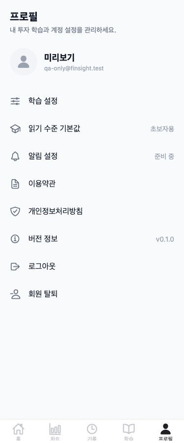

# 프로필 단일 메뉴 목록 — 375px

섹션 제목과 행 구분선을 제거하고 학습 설정 → 읽기 수준 기본값 → 알림 설정 → 이용약관 → 개인정보처리방침 → 버전 정보 → 로그아웃 → 회원 탈퇴 순서로 표시합니다. 8개 행 모두 높이 56px, outline 아이콘 22px/#667085, 간격 16px, 글자 16px/#101828/400입니다. 메뉴 컨테이너에 배경·테두리·radius·그림자가 없고 화살표도 없습니다. 로그아웃과 탈퇴도 같은 스타일입니다.

버전은 ‘버전 정보 / v0.1.0’ 행으로 옮겼고 하단 별도 문구는 삭제했습니다. 상단 프로필은 유지합니다. 로그아웃과 2단계 탈퇴 확인은 탭한 뒤 바텀시트로 표시하며 마지막 확인 전에는 실행하지 않습니다. 기본 읽기 수준 선택도 기존 시트를 유지합니다.

사용자 답변에 따라 웹 알림 행은 ‘준비 중’이며 모바일은 ‘꺼짐/켜짐’을 표시하고 탭하면 기존 판단 결과 알림 토글을 설정 시트에서 엽니다. 기본 꺼짐과 예약/취소 로직은 그대로입니다.

App에서 useFonts(Ionicons.font)를 호출하고 로딩이 끝나기 전에는 시작 화면을 유지합니다. 실패하면 아이콘을 불러오지 못했다는 안내를 표시합니다. [Expo 공식 아이콘 문서](https://docs.expo.dev/guides/icons/)의 사전 로드 방식을 사용하며 새 의존성은 추가하지 않았습니다.

## 실제 웹 빌드 확인

EXPO_NO_DOTENV=1로 실제 Expo 웹 빌드를 만든 뒤 375×900 브라우저에서 확인했습니다. 임시 export의 API 주소만 별도 localhost QA 서버로 연결했습니다. 앱 UI와 Ionicons 컴포넌트·번들 폰트는 실제 코드 그대로이며 사용자 정보만 QA 응답입니다. 실제 로그인/DB/유료 서비스는 호출하지 않았습니다.

- viewport=375, document.scrollWidth=375. 메뉴 8개 행 각각 높이 56px.
- 아바타 person과 메뉴 아이콘 8개 모두 실제 모양으로 표시. DOM에서 font-family=ionicons와 서로 다른 8개 glyph 확인. 점 대체 문자는 사용하지 않았습니다.
- 화면에서 섹션 제목·구분선·화살표·메뉴 박스·하단 버전 문구 없음.
- 로그아웃 시트 열기/취소, 탈퇴 2단계 경고/취소 확인. 삭제는 실행하지 않았습니다.
- 정적 검사: ProfileScreen의 sectionTitle/divider/chevron/styles.card/FinSight v0.1.0 검색 결과 0건.

## 테스트와 변경 파일

npm run typecheck && npm test: 77개 통과. 8개 행 순서·아이콘·스타일·값, 모바일 알림 시트 진입, 위험 동작 확인 전 미실행, Ionicons 폰트 준비 전 화면 대기를 테스트했습니다. Expo 웹 export도 성공했습니다.

변경: App.tsx, ProfileScreen/SettingsList.tsx, ProfileScreen/index.tsx, profileMenu.test.mjs, 이 보고서와 캡처. 백엔드/AI/DB/환경 파일/캐시 TTL/AuthRateLimiter/외부 호출 상한은 변경하지 않았습니다.

남은 확인: 모바일 실기기에서 설정 시트의 표시와 OS 알림 전달은 이번 웹 UI 검증에 포함하지 않았습니다.
