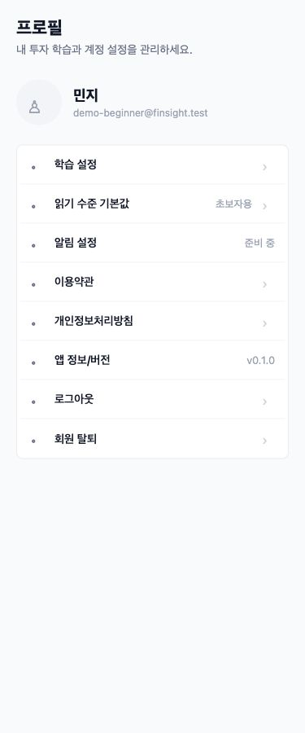
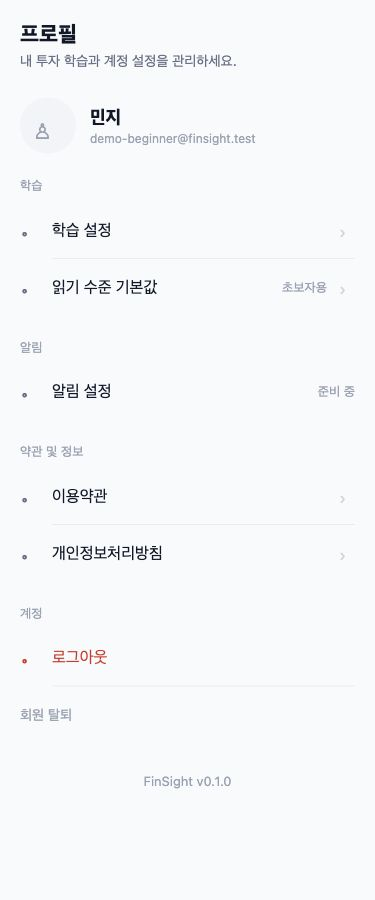
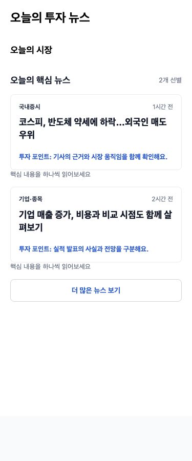

# 프로필·홈 UI 검증 — 375px

메뉴를 감싸는 흰 카드/테두리/radius를 삭제했습니다. 학습·알림·약관 및 정보·계정은 제목으로만 나누고, 각 56px 행은 #F8FAFC 화면 위에 직접 놓입니다. 구분선은 아이콘 뒤부터 시작하며 섹션 마지막 행에는 없습니다. 로그아웃은 빨강/화살표 없음, 탈퇴는 회색 14px/아이콘 없음입니다. 버전은 하단 중앙으로 옮겼고 읽기 수준 선택은 바텀시트입니다.

홈 핵심·더 보기 목록의 focusHint와 사용처가 없어진 상수를 삭제했습니다. 카드 안·배지·툴팁으로 옮기지 않았습니다. 기록 조회 실패 시 빈 상태 대신 ‘기록을 불러오지 못했어요 · 다시 시도’를 표시합니다.

캡처는 실제 TSX와 React Native Web 스타일을 렌더링한 **QA 픽스처**입니다. 사용자/뉴스 데이터와 아이콘은 캡처용이며 DB를 변경하지 않습니다. 375px 브라우저에서 scrollWidth=375로 가로 넘침이 없음을 확인했습니다. 실기기 OS 알림 검증과는 별개입니다.

| 화면 | 변경 전 | 변경 후 |
|---|---|---|
| 프로필 |  |  |
| 홈 |  |  |

정적 검사 `rg -n 'backgroundColor:.*#FFFFFF|styles.card' src/screens/profile/ProfileScreen` 결과 0건입니다. ProfileHeader의 아바타 원형 radius는 유지했고 메뉴 배경·테두리·radius는 없습니다. `focusHint`는 제품 소스에 남아 있지 않습니다. typecheck 및 프런트 테스트 66개 통과.
