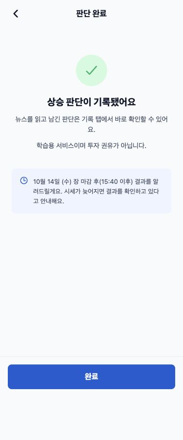
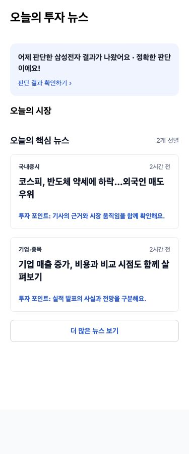
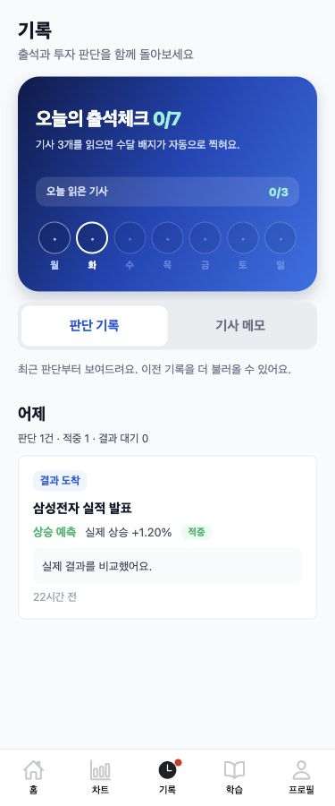

# 판단 결과 알림 검증

판단 제출/수정 ACK의 expectedResultDate를 완료 화면에 요일까지 표시합니다. 서버 KoreanTradingCalendar가 계산한 다음 거래일 15:40 KST 기준이며 프런트가 주말/휴장일을 임의로 계산하지 않습니다.

앱 진입/활성화와 홈 복귀 시 계정별 결과를 조회합니다. 캐시 TTL과 폴링 간격은 60초입니다. 기존 feedbackSeen 저장소를 재사용하고 상세 확인 이벤트를 공유해 홈 배너와 기록 탭 빨간 점을 갱신합니다. 변동률·비교일이 없는 대기/구버전/확인 불가 기록은 새 결과로 알리지 않습니다. 예정 시각이 지났어도 결과가 없으면 ‘결과를 확인하고 있어요’로 표시합니다.

기기 알림은 계정별 기본 꺼짐입니다. 모바일 프로필 ‘판단 결과 알림’에서 권한을 허용한 이후 제출/수정한 판단을 다음 거래일 16:00 KST로 예약합니다. 같은 기사 재판단은 이전 예약을 취소하고 다시 예약하며 토글을 끄면 해당 계정 예약만 취소합니다. 웹은 토글과 native API 호출 없이 앱 안 안내만 사용합니다. 서버 푸시·푸시 토큰 API를 호출하지 않으며 Expo 자동 서버 등록도 끕니다. 예약 메시지는 결과 확정을 주장하지 않습니다. 예약 실패해도 저장된 판단은 완료 화면으로 이동하고 실패 안내를 별도로 보여줍니다.

SDK/Android 정확한 알람 권한 설정은 [Expo 공식 문서](https://docs.expo.dev/versions/latest/sdk/notifications/)를 따랐습니다. 네이티브 바이너리를 다시 빌드해야 설정이 반영되며 Android의 정확한 알람 허용과 OS 절전/집중 모드에 따라 전달 시각이 달라질 수 있습니다. 실기기 전달 검증은 하지 않았습니다.

## 375px 캡처

실제 제품 TSX/React Native Web 스타일을 사용한 QA 픽스처입니다. 아래 시연 수치/뉴스는 화면 검증용이며 DB에 저장하지 않았습니다. 세 화면 모두 viewport와 scrollWidth가 375px입니다. 프로필/홈 전후 비교는 profile-ui.md에 있습니다.

| 판단 완료 | 홈 결과 배너 | 기록 탭 점 |
|---|---|---|
|  |  |  |

## 테스트와 데이터 확인

- 프런트 typecheck + 테스트 76개, 웹 export 성공. 다음 거래일 안내 매핑, 읽음/대기/레거시 판정, 배너/탭 점, 권한 거절, 기본 꺼짐, 취소/재예약, 계정 분리, 저장 성공 후 예약 실패를 mock으로 확인했습니다.
- 백엔드 Java 단위 161개 + Python 안전성 7개. 별도 PostgreSQL의 prod 마이그레이션/혼합 JSON MockMvc 통합 4개 통과.
- 실제 로컬 DB 구버전 배열 8건, 객체 1건, SQL NULL 19건. 형식은 수정하지 않았습니다.
- 별도 검증 서버에 실제 DB를 read-only로 연결하고 시작 시 수집/채점/시더를 mock으로 막은 뒤 사용자 8의 history/page 응답 200, content 5건, totalElements 5건을 확인했습니다. JWT는 검증 프로세스 안에서만 사용하고 출력/저장하지 않았습니다. 검증 서버는 종료했습니다.
- 원래 실행 중인 서버는 재시작하지 않았습니다. 시작 시 자동 catch-up이 기존 대기 판단을 채점할 수 있어 DB 변경 금지 지시를 우선했습니다. 최신 서비스 코드 적용은 별도 기동이 필요합니다.

변경 파일: JudgementResultsProvider/JudgementResultBanner, judgementResults/judgementNotifications/feedbackSeen/historyRecords, api/types, RootNavigator, HomeScreen/FeedbackScreen/JudgementScreen/JudgementDetailScreen, ProfileScreen/SettingsList, 관련 테스트, app.json/package.json/package-lock.json. 기존 JSON 읽기 호환과 예정일 API는 backend PR #110/#112, 프로필/홈 정리는 frontend PR #123에 의존하며 모두 먼저 병합됐습니다. 환경 파일·캐시 TTL·AuthRateLimiter·외부 호출 상한은 변경하지 않았고 유료 LLM 호출도 없습니다.
