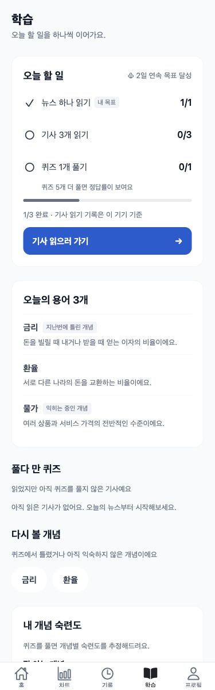
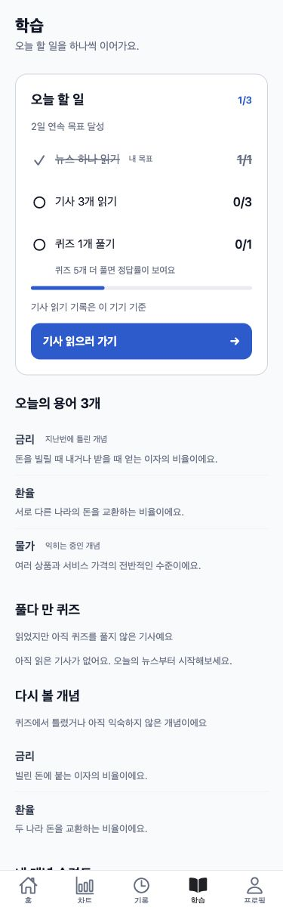
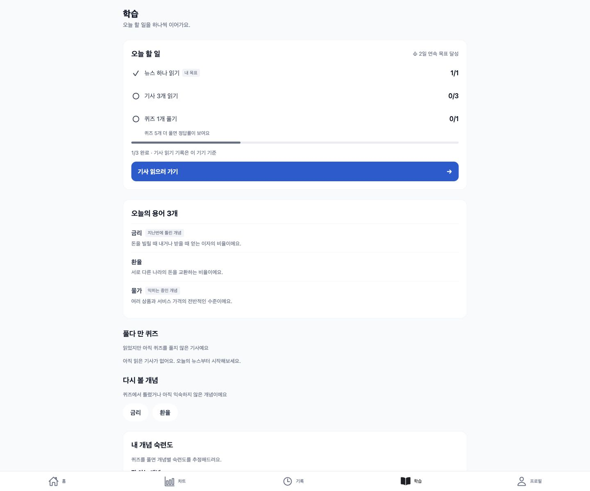
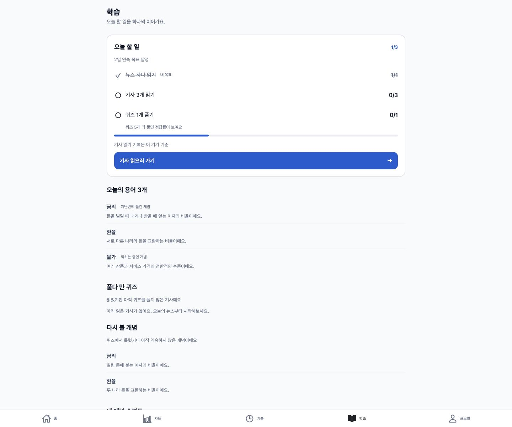

# 학습 탭 스타일 정리 — 2026-11-02

오늘 할 일은 surface 배경, borderStrong(#D0D5DD) 1px 테두리, radius.card로 표시한다. 헤더 왼쪽은 제목, 오른쪽은 작은 파란 완료 수(n/3)이며 연속 일수는 별도 보조 텍스트 줄로 옮기고 ♧ 기호를 제거했다. 파란 채움은 진행바와 주 버튼에만 사용한다. 헤더의 작은 완료 수는 사용자 요청 3번에 따른 파란 텍스트다.

완료 행의 라벨·값은 muted 색과 취소선, 체크는 muted로 표시한다. 미완료 행은 text 색이고 값은 오른쪽 정렬한다. 목표/읽기/퀴즈 집계와 CTA 이동 로직은 그대로 사용한다.

카드 아래는 흰 배경 박스를 반복하지 않는다. 용어·풀다 만 퀴즈·복습·추천·숙련도·가이드·팁을 제목과 행으로 정리하고 행 사이에 0.5px 선을 둔다. 복습 개념은 정의가 보이는 세로 목록이다. 가이드·팁·맞춤 연습의 하위 컴포넌트까지 포함해 메인 화면에서 오늘 할 일만 카드로 남겼다.

## 검증

- npm run typecheck 성공, npm test 152개 통과, expo export --platform web 성공.
- 브라우저 375px/1440px에서 가로 넘침 없음. 흰 배경·둥근 테두리 카드 1개 확인.
- 실제 렌더된 hero 테두리: 1px, rgb(208,213,221).
- 완료 라벨: rgb(102,112,133), line-through. 미완료 라벨: rgb(16,24,40), none.
- 브라우저 속성 확인 결과: browser-style-checks.json.

## 동일 조건의 변경 전후

변경 전은 21933ad와 제품 코드가 동일한 기존 웹 export, 변경 후는 이 PR의 웹 export다. 두 빌드는 격리된 동일 로컬 UI fixture API로 구동했다. 개인 목표 완료·기사 0/3·퀴즈 0개·연속 2일·같은 용어 3개와 복습 2개를 사용했다. 실제 운영 계정/성과나 실기기 검증으로 주장하지 않는다. fixture는 제품 코드에 추가하지 않았다.

| 화면 크기 | 변경 전 | 변경 후 |
|---|---|---|
| 375×1200 |  |  |
| 1440×1200 |  |  |

main 머지·운영 배포·DB·환경변수/키 변경 없음. 실기기 검증은 수행하지 않았다.
