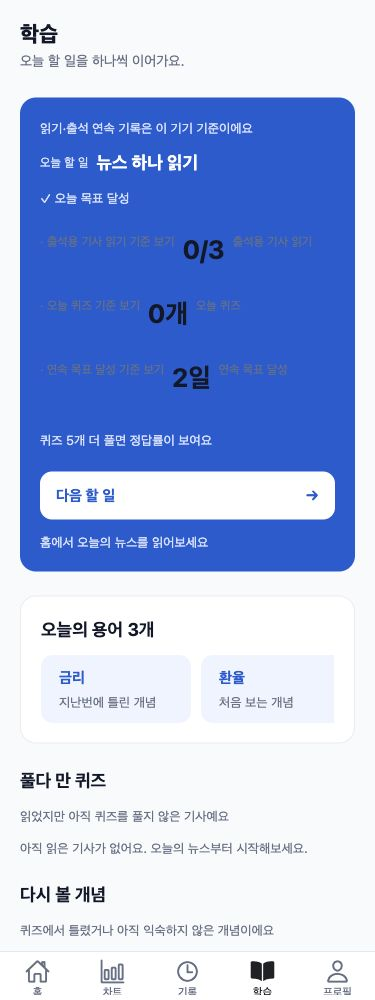
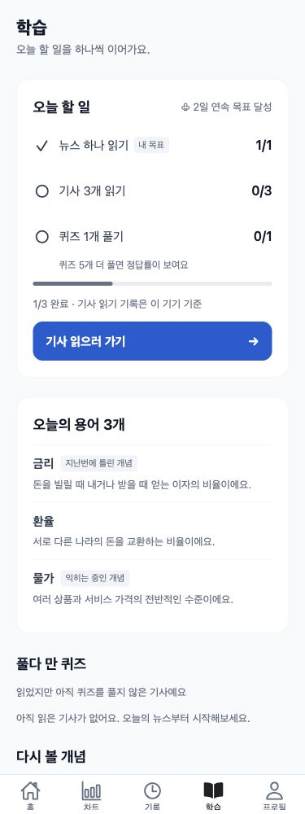
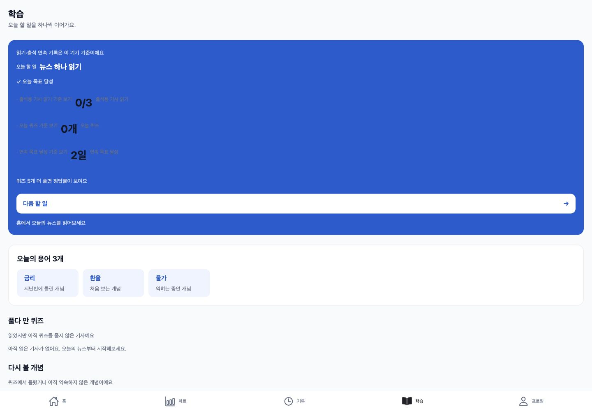
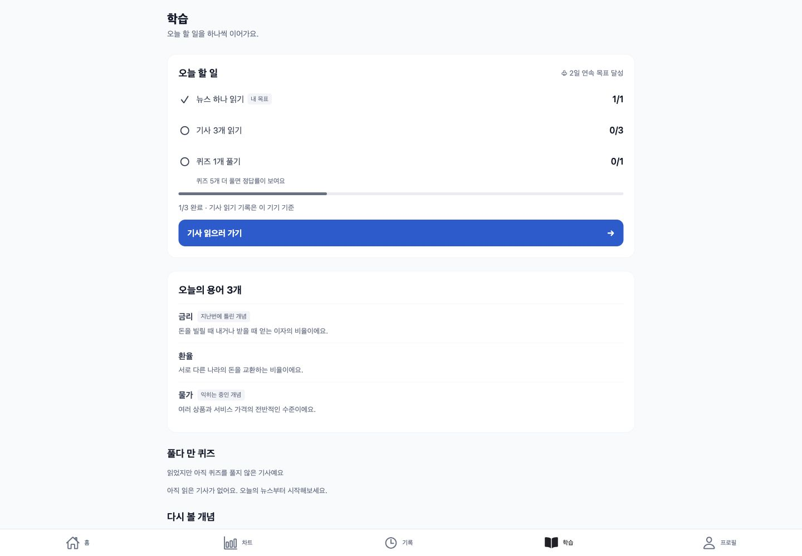

# P2-8 / P3 학습 탭 QA — 2026-11-02

학습 hero를 내 목표 1개·기사 3개·퀴즈 1개의 체크리스트로 교체했다. 완료 표시와 진행값을 각 행에 묶고, 전체 진행은 완료한 항목 수/3으로 별도 표시한다. 내 목표만 달성해도 “오늘 목표 달성”을 전체 완료 문구로 띄우지 않는다. 반대로 기사/퀴즈가 완료돼도 미완료 개인 목표는 남는다. 주 버튼은 첫 미완료 항목으로 이동하며 모두 완료하면 복습 영역으로 스크롤한다.

기본 목표는 사용자가 설정한 문구와 “내 목표” 배지를 사용한다. 메모 목표의 주 버튼은 기사로 이동해 메모를 연다. 5분 목표는 기존 활동 3개 근사 기준을 보조 문구로 유지한다. 퀴즈 선택은 미완료 기사→오답 개념→오늘 용어의 기사 순이며, 읽거나 풀 기사가 전혀 없으면 홈 기사 목록으로 이동한다.

일일 용어는 짧은 정의가 함께 보이는 세로 목록으로 바꿨다. “처음 보는 개념” 배지는 목록·접근성 이름·상세 sheet에서 숨기며, 오답/익히는 중 배지만 남긴다. hero와 용어/학습 카드의 배경은 흰색, 테두리 0.5px, 파란 강조는 주 버튼 한 곳에 둔다. 웹 최대 내용 폭은 880px이다. 기존 숙련도 카드의 진행바는 개념별 데이터이므로 유지하되 중립색으로 바꿨다. 오늘 할 일 카드 안의 진행바는 한 개다.

P2-8은 history/detail normalizer에서 pendingReason을 보존한다. NOT_DUE는 서버 expectedResultDate에서 한국 시간 날짜/요일을 계산해 15:40 이후 결과로 표시한다. PRICE_UNAVAILABLE는 시세 확인/자동 재시도, EXCLUDED_QA는 테스트 기록, CALENDAR_UNSUPPORTED는 달력 확인 필요로 표시한다. QA는 대기·적중 집계와 polling에서 제외하고 별도 테스트 기록 수로 표시한다. 기존 PRICE_ADJUSTMENT 안내 우선순위는 유지한다.

## 검증

- `npm run typecheck`, `npm test`: 152개 통과.
- `expo export --platform web`: 성공.
- 기존 learnScreenUi.test.mjs를 새 체크리스트/CTA/배지 구조에 맞게 수정. 개인 목표만 완료한 경우와 기사/퀴즈만 완료한 경우의 모순 방지, 전체 완료 시 복습 이동, 로딩·오류·제안 수준·기존 복습 동작을 검사.
- 예정일 상태별 라벨, 토요일 판단의 다음 월요일 예정일, QA/미지원 달력 polling 제외와 테스트 집계 검사. 2026-11-03은 실제 요일인 화요일로 표시한다.
- 브라우저에서 375/1440px 가로 넘침 없음, 용어 정의 열기와 첫 미완료 기사 목록 이동 확인.

## 스크린샷 조건

변경 전: `5b37257`의 실제 웹 export. 변경 후: `690146c`의 실제 웹 export(테스트/증거 문서만 추가한 후속 커밋과 제품 코드는 같다). API는 외부로 연결하지 않는 로컬 UI fixture 서버를 사용했다. 비교 조건은 두 빌드 모두 동일하다: 개인 목표 완료, 로컬 기사 0/3, 오늘 퀴즈 0개, 연속 2일, 같은 용어 3개. 이는 운영 계정/실제 사용자 성과가 아닌 화면 QA 데이터다. fixture나 mock API를 앱 코드/번들에 추가하지 않았다. 실제 기기·운영 Render의 네트워크 검증으로 주장하지 않는다.

| 크기 | 변경 전 | 변경 후 |
|---|---|---|
| 375×1000 |  |  |
| 1440×1000 |  |  |

운영 배포·main 머지·운영 DB 쓰기·환경변수·키 변경·외부 LLM 호출 없음. 읽기/출석은 기존처럼 기기 로컬 기록이고 화면에 그 기준을 명시한다.
